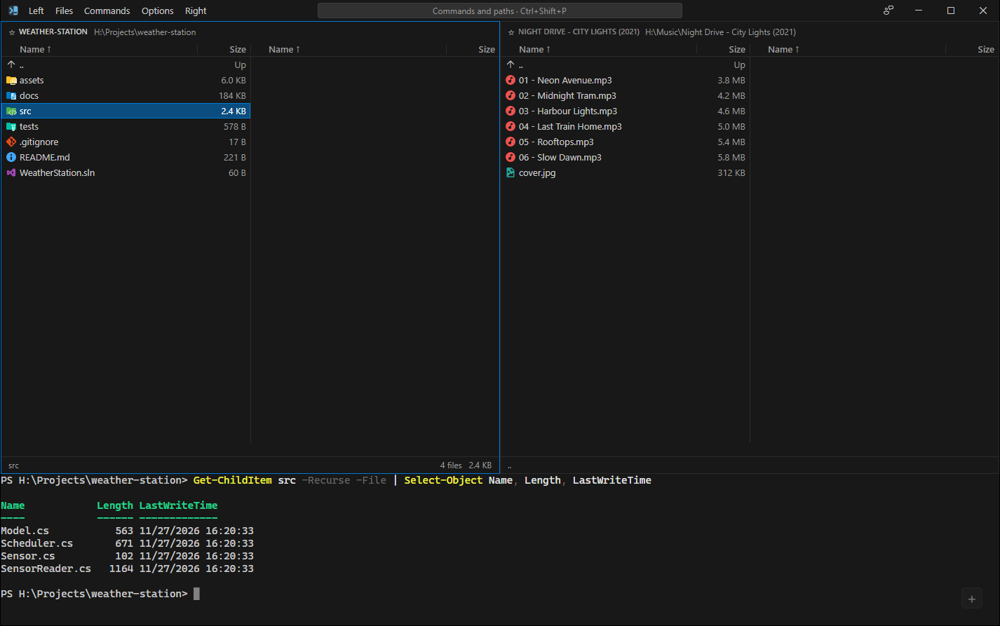
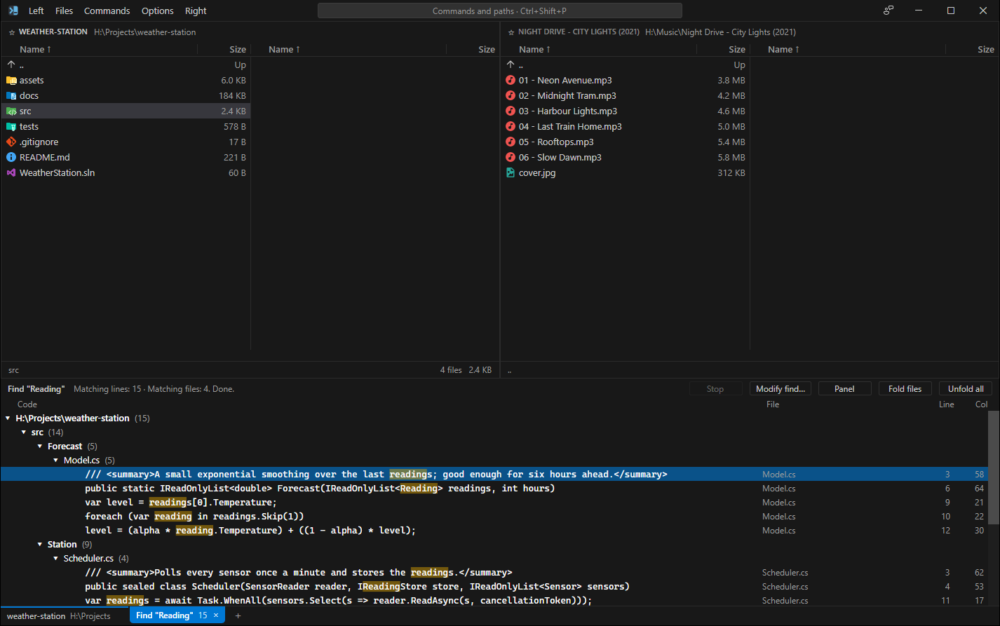
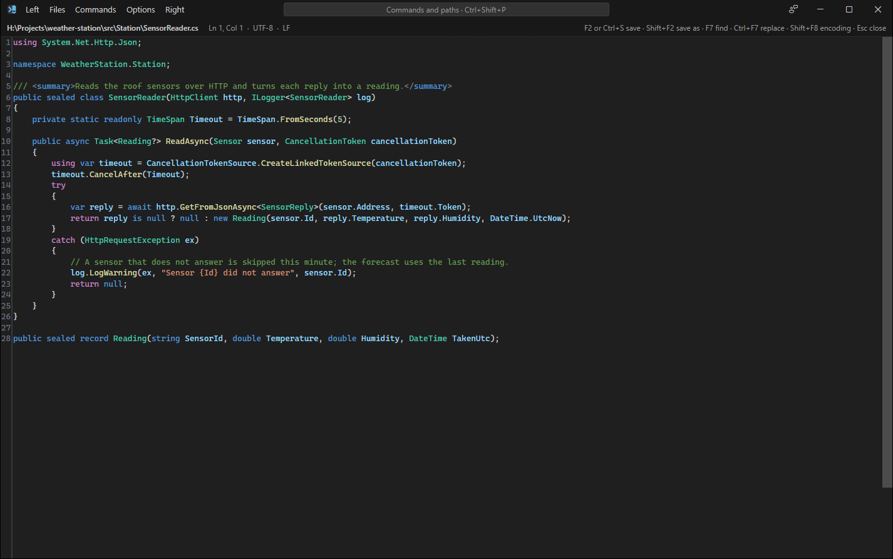
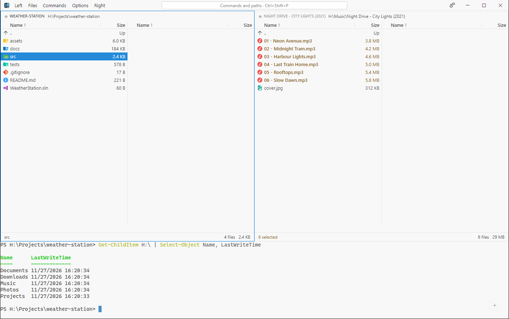

# Habilis Terminal

A two-panel file manager for Windows with a real PowerShell 7 console underneath: Far Manager's keys, VS Code's looks.



## What it does

**Panels**
- Fast, custom-drawn file lists: 100 000 files show their first screen in about 25 ms.
- Far's view modes (Ctrl+1 … Ctrl+0) and sorting, quick search, an info panel (Ctrl+L), and a quick view in the other panel (Ctrl+Q).
- Folder sizes are counted in the background, and hidden files can be shown or not.
- A drive menu (Alt+F1 / Alt+F2) with favorites (Ctrl+D), places and plugins. Folder history is on Alt+F12.
- Selection by mask or by type (Gray+ / Gray−): `<pictures>`, `<music>`, `<video>`, `<documents>`, `<archives>`, `<code>`.

**Files**
- Copy, move, delete and attributes run in the background with progress, pause and conflict questions.
- Deleting goes to the Recycle Bin. Long paths and links are handled.
- Removable drives eject from the ⏏ in the panel's header or in the drive menu, or with Ctrl+Shift+E.
- **Find file (Alt+F7)** looks by masks, types and text (also by regular expression, and inside archives). Each search opens a tab beside the consoles, shaped like Visual Studio's Find Results: folders, files and the matching lines.
  - Enter goes to a file or opens a line.
  - F3 / F4 view or edit at the line.
  - F2 makes the results a panel.

**Console**
- pwsh 7 runs through ConPTY, drawn by the app's own terminal emulator.
- The console and the panels stay in sync: `cd` moves the active panel, and moving in a panel moves the shell.
- Several consoles in tabs (Ctrl+Shift+T, Ctrl+Tab), each with its own panels. A command that finishes in a tab behind the others says so.
- The console can grow over the panels while a command prints; Ctrl+O hides the panels.

**Viewer and editor**
- F3 opens files of any size at once, as text or hex (memory-mapped), with encodings, search and go-to-line.
- Alt+F3 shows pictures, PDF and Markdown.
- F4 edits text with syntax colours and saves it byte for byte (encoding, BOM, line endings).

**Plugins**
- Plugins work as in Far: their own panels, files opened as folders, drive-menu entries, command-line prefixes such as `s3:`.
- They load and unload while the app runs. The plugin manager is on Alt+Shift+F9.
- The standard plugins ship with the app:

| Plugin | Shows |
|---|---|
| Archives | zip, 7z, rar, tar and more as folders, on 7-Zip: browse, extract, pack, passwords |
| S3 Browser | Amazon S3 buckets and objects as a file panel: copy both ways, delete, folder sizes |
| SQS Queues | Amazon SQS queues with their counts; inside a queue, its messages to view, delete, save and send |
| SageMaker | Amazon SageMaker training jobs of an account and region (read-only) |
| GitHub | your and your organizations' repositories, their branches with ahead / behind, and a branch's files (read-only) |
| Task Manager | a live process list, like Task Manager's Details page |
| GPU Monitor | GPU load, memory and processes, like nvtop |

- Writing a plugin: [docs/plugins.md](docs/plugins.md) and the SDK packages; the AWS plugins use your AWS profiles.

**Claude Control**
- `habi mcp` is an MCP server that lets Claude (Claude Code, Claude Desktop) see and drive the window. It can move the panels, run commands and console commands, open files and change settings.
- It is off by default. You choose "ask" or "trusted" in Settings. See [docs/claude-control.md](docs/claude-control.md).

**Looks and settings**
- VS Code Dark / Light Modern follow the Windows mode and accent colour. Any VS Code colour theme can go in the `themes` folder; Seti or Material file icons.
- Ctrl + mouse wheel zooms the whole interface.
- `settings.json` has a schema and reloads live. There is also a VS Code-style Settings page (F9 → Options → Settings).
- The command line (Ctrl+Shift+P) lists every command with its key. A pasted path or plugin address opens that place.

## Screenshots

**Find file (Alt+F7).** The results open as a tab, with the folders, the files and the matching lines.



**The editor (F4)** has syntax colours from the VS Code theme.



**Light Modern.** The theme follows Windows. In the right panel, Gray+ → Music has selected the songs.



## Install

- **Installer:** `HabilisTerminal-win-x64-Setup.exe` or `HabilisTerminal-win-arm64-Setup.exe` from [Releases](https://github.com/voronkovlabs/habilis-terminal/releases). It installs per user, needs no admin rights and updates itself from GitHub Releases.
- **Portable:** unzip `HabilisTerminal-<version>-<arch>-portable.zip` anywhere. Settings and state stay next to `habi.exe`.

PowerShell 7 is required:

```
winget install Microsoft.PowerShell
```

## Keys

F1 in the app shows the whole map, and Ctrl+Shift+P finds any command. The essentials:

| Keys | Action |
|---|---|
| Tab, Ctrl+O, Ctrl+U | Other panel, hide the panels, swap them |
| Enter, Ctrl+PgUp, Ctrl+\\ | Open, parent folder, root |
| F3, Alt+F3, F4, Shift+F4 | View, show in its program, edit, new file |
| F5, F6, F7, F8, F2 | Copy, move, make folder, delete, rename |
| Ins, Gray+, Gray−, Gray* | Select: one, by mask or type, deselect, invert |
| Alt+F1, Alt+F2, Alt+F12 | Drives for the left / right panel, folder history |
| Alt+F7 | Find file |
| Ctrl+L, Ctrl+Q, Ctrl+H, Ctrl+R | Info panel, quick view, hidden files, re-read |
| Ctrl+D, Ctrl+Shift+E | Favorite folder, eject the drive |
| Ctrl+Shift+T, Ctrl+Tab, Ctrl+Shift+W | New console, next tab, close the tab |
| Ctrl+E, Ctrl+X | Previous, next command |
| Ctrl+Shift+C, Ctrl+Shift+V | Copy from, paste into the console |
| F9, F11, F10 | Menu, plugins, exit |

## macOS: help wanted

Habilis Terminal is Windows-first, but a Mac version is within reach.

**What already exists**
- The UI is [Avalonia](https://avaloniaui.net), which runs on macOS.
- The terminal emulator is the app's own, not a Windows control.
- Windows calls sit behind platform interfaces, with a portable implementation for other systems (#259).
- A macOS port got as far as:
  - an app bundle for Apple Silicon and Intel (#276);
  - Cmd keys as Mac users expect (#272);
  - files and drives as the Finder shows them (#274);
  - a CI job that builds and screenshots the app on `macos-latest`.

**What is open**
- The Mac direction is paused for now (#322) because nobody here uses a Mac every day. The Mac release job is switched off, and nothing Mac-specific has been tested since.
- What a Mac version still needs:
  - a Mac user's eye on keys and looks;
  - signing and notarization;
  - testing on real machines.

**Contributions from Mac users are very welcome:** bug reports, fixes, or taking the port on. Open an issue or a pull request. [docs/development.md](docs/development.md) describes the build and the macOS CI workflow.

## Build

Requires the .NET 10 SDK and PowerShell 7.

```
dotnet build
dotnet test
dotnet run --project src/HabilisTerminal.App
```

The standard plugins build with `tools/plugins/Build-Plugins.ps1`. Tests touch only `%TEMP%\habi-tests`.

[docs/development.md](docs/development.md) covers UI checks, keyboard routing and releases. A release is built by pushing a `vX.Y.Z` tag (`.github/workflows/build.yml`). `packaging/winget` holds the winget manifests.

## License

MIT, see [LICENSE](LICENSE). Bundled third-party material is listed in [ThirdPartyNotices.txt](ThirdPartyNotices.txt).
